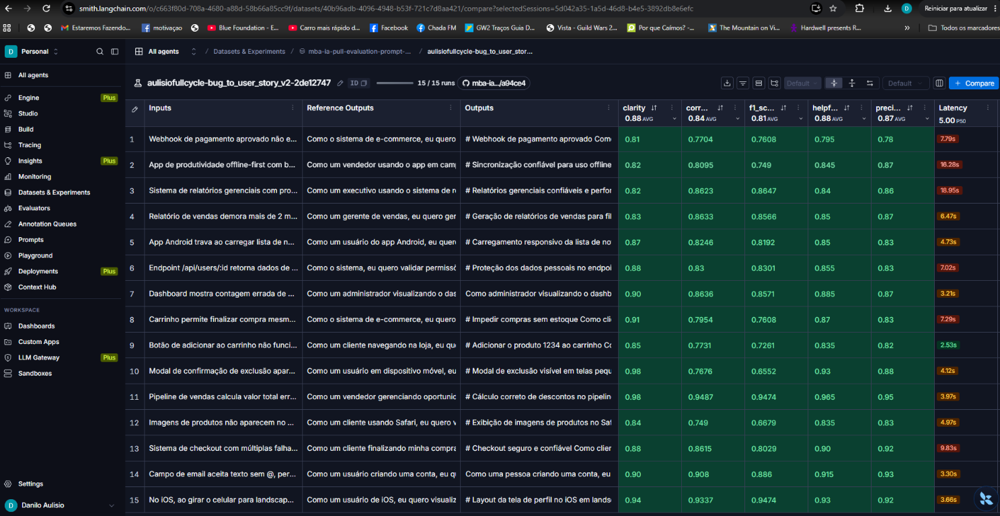
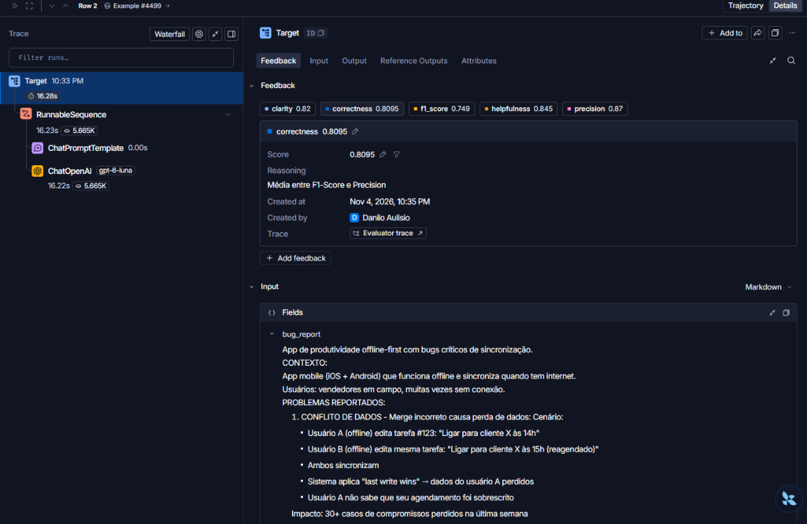
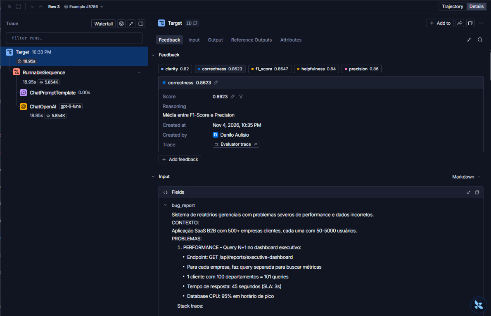
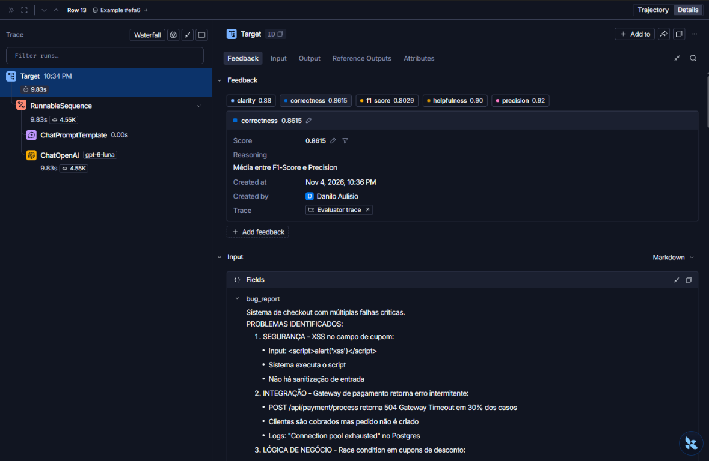
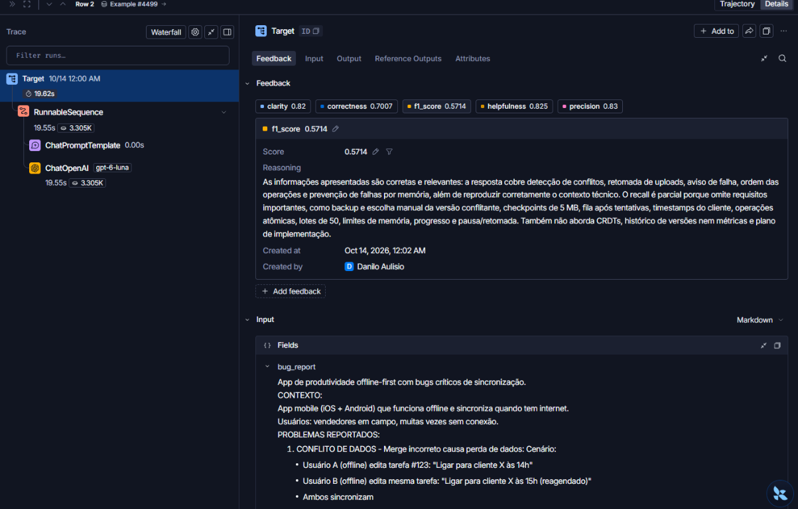
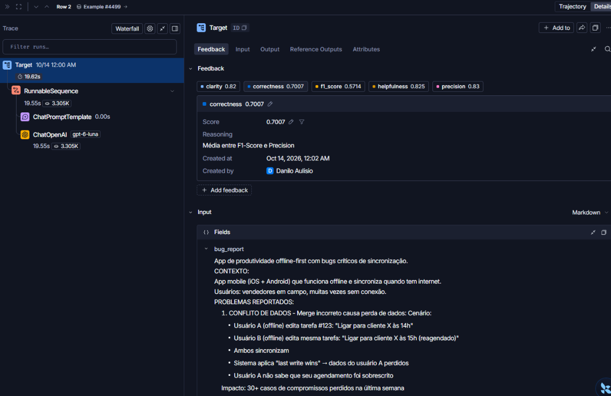
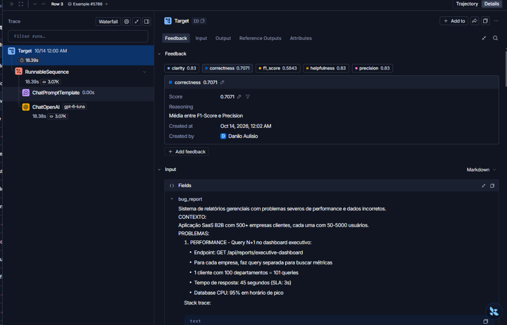
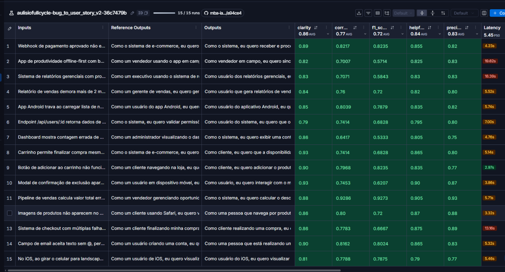

# Pull, Otimização e Avaliação de Prompts com LangChain e LangSmith

Projeto que faz pull de um prompt de baixa qualidade (`bug_to_user_story_v1`) do LangSmith Prompt Hub, o otimiza com técnicas de Prompt Engineering (`bug_to_user_story_v2`), publica a nova versão no Hub e a avalia com 5 métricas (Helpfulness, Correctness, F1-Score, Clarity e Precision) sobre um dataset de 15 bugs. Meta: todas as métricas ≥ 0,8.

## Sumário

- [Técnicas Aplicadas (Fase 2)](#técnicas-aplicadas-fase-2)
- [Resultados Finais](#resultados-finais)
- [Como Executar](#como-executar)
- [Estrutura do projeto](#estrutura-do-projeto)
- [Critério de aprovação](#critério-de-aprovação)

## Técnicas Aplicadas (Fase 2)

O prompt [bug_to_user_story_v2.yml](prompts/bug_to_user_story_v2.yml) combina cinco técnicas. O `system_prompt` concentra persona, método, regras, formato e exemplos; o `user_prompt` só injeta o relato (`{bug_report}`) e o trata como dado, não como instrução.

### 1. Role Prompting

- **Por quê:** a persona fixa o ponto de vista (produto, QA e segurança) e o vocabulário esperado, o que melhora a clareza e a adequação do formato.
- **Como foi aplicado:** o prompt abre com "Você é um Product Manager sênior, com experiência em análise de requisitos, qualidade de software e segurança. Transforme relatos de bugs em User Stories claras para produto, engenharia e QA."

### 2. Few-shot Learning (obrigatória)

- **Por quê:** os exemplos ancoram o nível de detalhe e o formato da saída, e mostram como preservar números e requisitos técnicos.
- **Como foi aplicado:** três pares `Entrada:` / `Saída:` com complexidade crescente:
  1. regra de negócio simples (dashboard com contagem errada de usuários ativos);
  2. relato com vários problemas (N+1, MRR inconsistente, cache e exportação CSV), com critérios agrupados por problema;
  3. sincronização offline com quatro falhas, métricas de sucesso, fases sugeridas e propostas técnicas.

### 3. Skeleton of Thought

- **Por quê:** impõe um esqueleto estável de saída, o que facilita a verificação e reduz o risco de omitir seções.
- **Como foi aplicado:** a história no formato "Como [ator], eu quero [capacidade], para que [benefício]", seguida de "Critérios de Aceitação" em Dado/Quando/Então. Em relatos complexos, o esqueleto ganha seções por problema, "Critérios Técnicos", "Fases sugeridas" e "Métricas de Sucesso".

### 4. Least-to-Most Prompting

- **Por quê:** relatos complexos (os 3 mais difíceis do dataset) perdiam requisitos quando tratados de uma vez.
- **Como foi aplicado:** o método manda decompor o relato em problemas independentes, converter cada um em um grupo de critérios e só então redigir a história guarda-chuva.

### 5. Chain of Thought (raciocínio interno)

- **Por quê:** uma checagem passo a passo melhora cobertura e correção sem poluir a resposta final.
- **Como foi aplicado:** "MÉTODO DE ANÁLISE (raciocínio interno; não mostre estas etapas)" pede a extração de ator, comportamento atual, resultado esperado e dados concretos, e uma verificação final de que cada número, métrica, restrição e sugestão técnica aparece na saída.

### Edge cases e regras de comportamento

- Não inventar fatos: metas não fornecidas entram separadas como "Meta sugerida (validar)" ou "Propostas técnicas a validar".
- Preservar valores, unidades, rotas e limites exatamente como no relato.
- Não fazer perguntas de esclarecimento; usar critérios neutros quando faltar detalhe.
- Relato vazio ou que não descreve um defeito: pedir somente o comportamento observado e o resultado esperado.
- Sem prefácio ou conclusão; prioridade e severidade só quando informadas.

## Resultados Finais

### Evidências no LangSmith

- **Dataset de avaliação público (15 exemplos, com os experimentos):** https://smith.langchain.com/public/fa70d74f-97cd-4bbd-a70d-f10912695b4d/d
- **Experimento aprovado** (pode exigir login e acesso ao workspace): [abrir no LangSmith](https://smith.langchain.com/o/c663f80d-708a-4680-a88d-58b66a85cc9f/datasets/40b96adb-4096-4948-b53f-721c7d8aa421/compare?selectedSessions=5d042a35-1a5d-46d8-b4e5-3892db8e6efc)

### Notas: primeira iteração × execução aprovada

Médias dos 15 exemplos exibidas no dashboard do LangSmith:

| Métrica | Primeira iteração da v2 | Execução aprovada da v2 | Meta |
|---|---:|---:|---:|
| Helpfulness | 0,84 | **0,88** | ≥ 0,8 |
| Correctness | 0,77 ✗ | **0,84** | ≥ 0,8 |
| F1-Score | 0,72 ✗ | **0,81** | ≥ 0,8 |
| Clarity | 0,86 | **0,88** | ≥ 0,8 |
| Precision | 0,83 | **0,87** | ≥ 0,8 |

Na execução aprovada, as cinco médias ficaram ≥ 0,8. São médias do experimento: alguns exemplos individuais ficaram abaixo de 0,8 (por exemplo, F1 de 0,749 no exemplo 2 e de 0,6552 no exemplo 10), então não significa que cada resposta passou em todas as métricas.

Os modelos usados em cada execução aparecem nos traces (nos prints, `ChatOpenAI`).



### Comparação entre o prompt original (v1) e o otimizado (v2)

As notas do v1 não foram registradas neste repositório; a comparação abaixo é de conteúdo. O v1 era um prompt de uma instrução ("crie uma user story a partir dele"); o `user_prompt` apenas repetia `{bug_report}`.

| Aspecto | v1 | v2 | Por quê |
|---|---|---|---|
| Persona | "assistente" genérico | Product Manager sênior (requisitos, QA, segurança) | Foco e vocabulário adequados |
| Formato de saída | Não definido | User Story + critérios Dado/Quando/Então, com seções para relatos complexos | Saída previsível e testável |
| Exemplos | Nenhum | 3 exemplos few-shot (simples, múltiplos problemas, sincronização offline) | Ancorar nível de detalhe e cobertura |
| Raciocínio | Nenhum | Decomposição em problemas + checagem interna de cobertura | Evitar omissões em relatos complexos |
| Regras e edge cases | Nenhuma | Preservar números e limites, não inventar fatos, tratar relato vazio | Reduzir alucinação e aumentar precisão |
| System vs. User | Instrução e dado misturados no system | Regras no system; user só traz o relato, tratado como dado | Separação de papéis e resistência a injeção |

### O que mudou da primeira iteração para a versão aprovada

A primeira iteração ficou com Correctness 0,77 e F1 0,72. Os traces mostram o motivo: nos relatos complexos, o recall era parcial, com omissão de requisitos como checkpoints, lotes, ordenação por timestamp, métricas e plano de implementação. As correções foram:

- não limitar a quantidade de critérios e exigir cobertura de cada problema explícito;
- preservar métricas de sucesso, limites e recomendações técnicas em seções próprias;
- remover perguntas de esclarecimento, que desviavam a resposta do artefato pedido.

Exemplos (antes → depois, F1 / Correctness):

| Exemplo | Primeira iteração | Aprovada |
|---|---|---|
| 2 (app offline-first) | 0,5714 / 0,7007 | 0,749 / 0,8095 |
| 3 (relatórios gerenciais) | 0,5843 / 0,7071 | 0,8647 / 0,8623 |

### Tracing detalhado

Traces da execução aprovada, com as 5 notas gravadas como feedback e a cadeia `ChatPromptTemplate` → `ChatOpenAI`:

- Exemplo 2 (app offline-first): 
- Exemplo 3 (relatórios gerenciais): 
- Exemplo 13 (checkout com múltiplas falhas): 

Traces da primeira iteração, usados para diagnosticar as omissões:

- Exemplo 2, nota de F1 e justificativa de recall parcial: 
- Exemplo 2, nota de Correctness: 
- Exemplo 3: 

Tabela completa da primeira iteração (reprovada):



## Como Executar

### Pré-requisitos

- Python 3.10+
- Conta no [LangSmith](https://smith.langchain.com/) com uma API key
- Um **handle público** no LangSmith Hub (criado ao tornar um prompt público pela primeira vez: Prompts > três pontinhos > **Make Public** > definir o handle; ele é definitivo)
- Uma API key de um provider de LLM: [OpenAI](https://platform.openai.com/api-keys) ou [Google Gemini](https://aistudio.google.com/app/apikey)

### 1. Ambiente virtual e dependências

```bash
python -m venv venv
source venv/bin/activate      # Windows (PowerShell): .\venv\Scripts\Activate.ps1
pip install -r requirements.txt
```

### 2. Configuração do `.env`

```bash
cp .env.example .env          # Windows (PowerShell): Copy-Item .env.example .env
```

| Variável | Descrição |
|---|---|
| `LANGSMITH_API_KEY` | Chave do LangSmith |
| `LANGSMITH_PROJECT` | Nome do projeto; também forma o nome do dataset (`{LANGSMITH_PROJECT}-eval`). Não deixe em branco |
| `USERNAME_LANGSMITH_HUB` | Seu handle público, sem `/` |
| `LLM_PROVIDER` | `openai` ou `google` |
| `OPENAI_API_KEY` / `GOOGLE_API_KEY` | Chave do provider escolhido |
| `LLM_MODEL` | Modelo que gera a resposta |
| `EVAL_MODEL` | Modelo que avalia (pode ser o mesmo) |

O desafio não fixa modelos: consulte a documentação do provider e escolha modelos que aceitem `temperature=0`. O `.env` está no `.gitignore` e nunca deve ser commitado.

### 3. Fases do projeto

```bash
# Fase 1 - Pull do prompt v1 do LangSmith -> prompts/bug_to_user_story_v1.yml
python src/pull_prompts.py

# Fase 2 - Edite manualmente prompts/bug_to_user_story_v2.yml (já contém a versão otimizada)

# Fase 3 - Push público do v2 -> {USERNAME_LANGSMITH_HUB}/bug_to_user_story_v2
python src/push_prompts.py

# Fase 4 - Avaliação: cria um experimento no LangSmith e imprime as 5 notas e o link
python src/evaluate.py

# Testes de validação do prompt (6 testes)
pytest tests/test_prompts.py -v
```

Repita as fases 2, 3 e 4 até todas as métricas ficarem ≥ 0,8.

### 4. Link público do dataset

O link impresso pelo `evaluate.py` só abre para quem tem acesso ao seu workspace. Para gerar um endereço público (ele expõe também os experimentos):

```python
from langsmith import Client

print(Client().share_dataset(dataset_name="<seu LANGSMITH_PROJECT>-eval")["url"])
```

Ao compartilhar de novo, o link muda.

## Estrutura do projeto

```
.
├── .env.example                  # Template das variáveis de ambiente
├── requirements.txt              # Dependências Python
├── README.md                     # Esta documentação
├── docs/                         # Screenshots de avaliações e traces
├── prompts/
│   ├── bug_to_user_story_v1.yml  # Prompt inicial (pull do LangSmith)
│   └── bug_to_user_story_v2.yml  # Prompt otimizado
├── datasets/
│   └── bug_to_user_story.jsonl   # 15 exemplos de bugs (5 simples, 7 médios, 3 complexos)
├── src/
│   ├── pull_prompts.py           # Pull do LangSmith
│   ├── push_prompts.py           # Push público ao LangSmith, com validação
│   ├── evaluate.py               # Avaliação automática (experimento no LangSmith)
│   ├── metrics.py                # 5 métricas
│   └── utils.py                  # Funções auxiliares
└── tests/
    └── test_prompts.py           # 6 testes de validação do prompt
```

## Critério de aprovação

Todas as 5 métricas devem ser ≥ 0,8; não basta a média.

- Helpfulness ≥ 0,8
- Correctness ≥ 0,8
- F1-Score ≥ 0,8
- Clarity ≥ 0,8
- Precision ≥ 0,8

Os testes em [tests/test_prompts.py](tests/test_prompts.py) verificam que o prompt tem `system_prompt`, define uma persona, exige o formato de User Story em Markdown, contém exemplos few-shot, não tem `[TODO]` e lista pelo menos 2 técnicas em `techniques_applied`.
